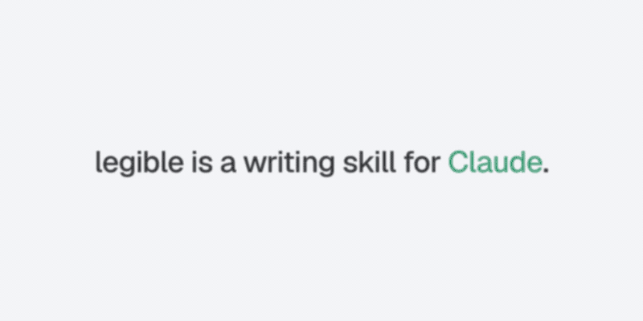

# legible

[English](README.md) · [繁體中文](README.zh-HK.md)

<p align="center"><a href="assets/legible.mp4"></a><br><sub>Click for the MP4.</sub></p>

**legible** is a writing skill for Claude. It makes the model write sentences a person understands on the first read.

It is built on one paper: Clark, Martin & Mahowald (2026), [*Why is AI-generated language so hard to understand?*](https://arxiv.org/html/2610.29162v1) (arXiv:2610.29162).

- Skill: [`skills/legible/SKILL.md`](skills/legible/SKILL.md)
- Worked examples, all quoted from the paper: [`skills/legible/references/examples.md`](skills/legible/references/examples.md)

## The idea in 30 seconds

People read one word at a time. Two things make them stop and go back:

| Cost | What happens | Example from the paper |
|---|---|---|
| **Prediction** | You guessed the next word and were wrong | "The whole conversation is *eating*…" Conversations don't eat. |
| **Memory** | You hold the subject too long before the verb arrives | "The *guitar* sitting in the corner because you're still 'deciding' *teaches* you zero chords." Eight words sit between *guitar* and *teaches*. |

The paper found that all nine frontier and near-frontier models tested overuse these constructions compared with human text and with meaning-preserving paraphrases. It argues the cause is post-training that rewards correct, short answers, not clear ones. A length penalty alone was enough to push a small model to drop optional words almost every time.

legible turns those findings into seven checks the model runs on its own draft:

1. Inanimate subject, animate verb ("chaos expects you to…")
2. Long gap between subject and verb
3. Dropped *that* where it causes a misread ("knew the answer was wrong")
4. Three or more stacked nouns ("class-time shutdown requirement")
5. A noun used as a verb with no convention behind it ("footnote it")
6. A coined word pair ("reader-patience budget")
7. A metaphor standing in for a literal phrase

**The governing rule is contextual, not categorical.** The paper's core finding is that models turned a contextual human choice into a fixed rule. Flipping that to "always add *that*" would repeat the same mistake in the other direction. legible fixes a sentence only when a first-time reader would stall on it, and keeps terms of art and the writer's own voice.

## Install

As a Claude Code plugin (2.1.275 or later):

```
/plugin marketplace add jason-in-hub/legible
/plugin install legible@legible
```

Or copy the skill by hand. One project:

```bash
mkdir -p .claude/skills && cp -R skills/legible .claude/skills/
```

Every project:

```bash
mkdir -p ~/.claude/skills && cp -R skills/legible ~/.claude/skills/
```

Then ask for "reader-friendly", "clearer", or "plainer" text, or invoke it directly with `/legible`. It has three operations: **write** (silent pass on new text), **review** (diagnose only) and **revise** (review, then fix).

## Why Sepia went viral, and what legible copies and skips

legible started from [Sepia](https://github.com/Nanako0129/sepia), the de-AI writing skill. Each point below is marked **Confirmed** (seen in a source) or **Inference** (my reading of why it worked).

| What Sepia did | Evidence | Why it spread |
|---|---|---|
| Turned one paper into a skill and said so in the launch title ("I turned the StoryScope paper into a de-AI writing skill", r/ClaudeAI) | **Confirmed** | **Inference:** "paper → tool" gives the claim borrowed authority and a one-line story people can share. |
| Positioned against 40+ existing humanizers: "De-AI writing at the layer that actually gives AI away", with a "Why another humanizer" section | **Confirmed** (README; the v0.2.0 commit cites a 40+ project survey) | **Inference:** a clear wedge (structure, not word bans) answers "why not just ban *delve*?" |
| Put measured numbers in the first paragraph (93.2% macro-F1 narrative classifier, 84.8% on the 30-feature rubric) | **Confirmed** (SKILL.md) | **Inference:** numbers read as rigour, even to readers who don't check them. |
| Installs on many agents: 77+ via the Skills CLI, native plugins for Claude Code, Codex, Grok Build and Antigravity | **Confirmed** (repo About) | **Inference:** no audience is locked out, so every agent community can repost it. |
| Chinese READMEs (zh-CN, zh-TW) and a Chinese language pass | **Confirmed** | **Inference:** opened a second, large audience on day one. |
| Shipped with evals in CI, a research ledger and a 389-commit history | **Confirmed** | **Inference:** signals maintenance, so people trust it enough to install. |
| Early traction: "close to 500 GitHub stars in about a day"; listed at about 3.6k stars on SkillsLLM | **Confirmed** (LinkedIn post; SkillsLLM listing). 需驗證: star counts move. | — |

**What legible copies:** a single-paper basis, labelled evidence (Confirmed vs Inference), a "keep" list so it doesn't over-correct, and worked examples quoted from the source.

**What legible deliberately skips:**
- **Cross-model fingerprinting.** Sepia resolves an author model and an executor model and loads per-family tables. legible checks the reader's cost, not who wrote the text.
- **Detector framing.** Sepia's goal is "read as human-written". legible's goal is "understood on the first pass". Those overlap but aren't the same, since a human-sounding sentence can still be hard to read.
- **Weight.** Sepia's skill runs about 1,450 lines across 20 reference files. legible is one SKILL.md plus one examples file, so it can run as a cheap pass on every draft.

Sepia's own research ledger records this paper as "Consulted, no rule" (commit of 2026-11-02). legible covers that gap. The two stack well: run legible first for sentence-level clarity, then Sepia for structure and venue.

## Limits

- The paper is English-only and ran no reader experiment. The reading-cost claims come from earlier psycholinguistics.
- The seven checks and the "plain-translation test" are this skill's inferences. They haven't been tested as writing interventions.
- **The A/B eval ([`eval/`](eval/README.md)) is a mixed result.** Against no instruction, the skill wins the blind judge 32–2 with 6 ties (p ≈ 7e-8), but partly by saying less: the judge rated the baseline more complete in 28 of 40 pairs. Against a one-sentence "write clearly" instruction, it loses 7–15 with 18 ties (not significant). In single-turn use, the skill doesn't yet beat the cheap prompt. Next tests: a slim no-examples variant, revise mode, and long multi-turn sessions.

## About the animation

The animation at the top was made once with [cinetic](https://github.com/Leonxlnx/cinetic) (v1.5.1), in its "feature loop" format, on its Remotion starter, house tokens and easing. The on-screen script passed cinetic's `copy-check.py` (verdict: clear, 0 errors) before any picture work. The music and sound steps were skipped because a README GIF is silent. The source is in [`media/legible-film/`](media/legible-film/). The MP4 is [`assets/legible.mp4`](assets/legible.mp4).

## Sources

- Clark, T. H., Martin, M. B., & Mahowald, K. (2026). *Why is AI-generated language so hard to understand?* arXiv:2610.29162.
- 程序员老王, [AI味到底是什么？](https://www.youtube.com/watch?v=ijp2IpmGBdY) (2026-11-05). A Chinese walkthrough of the paper, and the source of the "eating its own tail" framing.
- [Nanako0129/sepia](https://github.com/Nanako0129/sepia), the reference skill.
