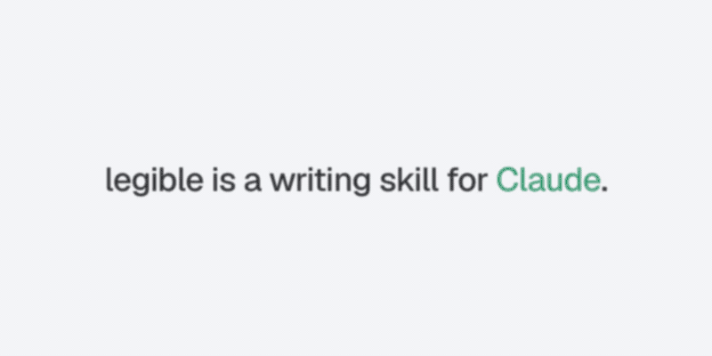

# legible

[English](README.md) · 繁體中文

<p align="center"><a href="assets/legible.mp4"></a></p>

**legible** 係一個 Claude 寫作 skill，目標係令讀者**第一次讀就明**。佢唔係「去 AI 味」工具，唔扮人寫，亦唔識估邊個 model 寫。

基礎係一篇 paper：Clark、Martin、Mahowald（2026），《[Why is AI-generated language so hard to understand?](https://arxiv.org/html/2610.29162v1)》（arXiv:2610.29162）。

## 一分鐘睇完個概念

人類逐字讀。有兩樣嘢會令讀者停低、返轉頭：

| 成本 | 發生咩事 | Paper 例子 |
|---|---|---|
| **預測失敗** | 你估下一個字，估錯 | "The whole conversation is *eating*…"，會議唔識食嘢 |
| **記憶超載** | 主語要記住太耐，動詞先出現 | "The *guitar* sitting in the corner because you're still 'deciding' *teaches* you zero chords."，*guitar* 同 *teaches* 中間隔咗 8 隻字 |

Paper 發現：測試咗嘅 9 個 frontier / near-frontier model，都比人類文字同「保持原意嘅 paraphrase」更常用呢啲寫法。作者嘅解釋係 post-training 獎勵「又短又啱」嘅答案，唔係「易明」嘅答案。淨係加 length penalty，已經足夠令一個細 model 幾乎次次省略 optional 嘅字。

legible 將發現變成 7 個 check：

1. 死物做生物動作（"chaos expects you to…"）
2. 主語同動詞之間隔太遠
3. 會令人誤讀嘅 *that* 被省略（"knew the answer was wrong"）
4. 三個或以上名詞疊埋
5. 名詞硬當動詞用（"footnote it"）
6. 自創字詞組合（"reader-patience budget"）
7. 用比喻代替直接講

**核心規則：睇 context，唔係死規則。** Paper 嘅重點係 model 將「睇 context 先決定」嘅選擇變成死規則。所以反過嚟「永遠加 *that*」都係同一個錯。legible 只改讀者真係會卡住嘅句，行內術語同作者自己嘅 voice 都保留。

## 安裝

Claude Code plugin（2.1.275 或以上）：

```
/plugin marketplace add jason-in-hub/legible
/plugin install legible@legible
```

## Eval 結果（誠實版）

做咗兩輪 A/B：[`eval/`](eval/README.md)。第二輪係預先登記（pre-registered）嘅。

- 對比「完全冇指示」：skill 大勝，但一句 prompt 都一樣咁勝（placebo 對 base：write 25–0，revise 12–0）。
- 對比「一句：寫到讀者第一次讀就明」：完整版 skill 喺 write 任務 1 勝 13 負（Holm p = 0.007），即係**顯著差過一句 prompt**。精簡版同 revise 模式都冇贏到。
- 我之前估「revise 模式 checklist 會贏」，結果被推翻。
- 結論：legible 唔值得當 prompt 裝。實用做法係直接用呢句：*Write so a human reader understands every sentence on the first read. Prefer plain, clear sentences.* 呢個 repo 嘅價值係 paper 解讀同手動改稿參考。

仲未測：長多輪對話、跨 model 家族嘅 judge、真人讀者。

## 限制

- Paper 只做英文，亦冇做 reader experiment；閱讀成本嚟自之前嘅心理語言學研究。
- 7 個 check 同 plain-translation test 係本 skill 嘅推論，未經作為寫作介入測試過。
- 呢個 README 嘅中文版係人手按英文版整理，冇另外測過中文文字上嘅 7 個 check（兩個成本適用，具體 row 未驗證）。
